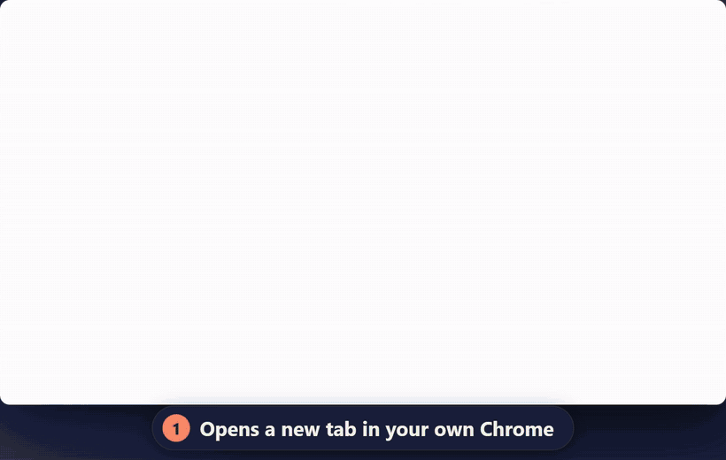
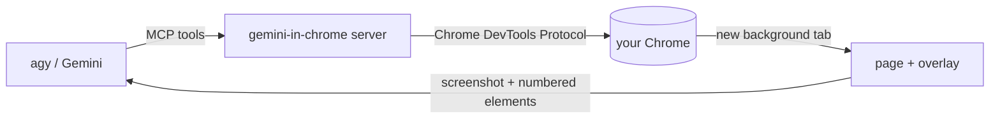

<p align="center">
  
</p>

<h1 align="center">gemini-in-chrome</h1>

<p align="center">
  <b>Let Gemini use your real Chrome.</b><br>
  A new background tab, a visible cursor and glow, your existing logins. No extension to install.
</p>

<p align="center">
  <a href="https://github.com/Inder782/gemini-in-chrome/actions/workflows/ci.yml"></a>
  <a href="LICENSE"></a>
  
  
</p>

<p align="center">
  
</p>

`gemini-in-chrome` is a small [MCP](https://modelcontextprotocol.io) server that gives an AI agent (built for
Gemini through `agy`, works with any MCP client) the same kind of browser control that "Claude in Chrome" gives Claude:
it opens a tab in **your** Chrome, reads the page, and clicks and types with real mouse and keyboard events, while you watch.

- **Your Chrome, your logins.** Attaches through Chrome's own official remote-debugging switch. Nothing to install in the browser.
- **You can see it work.** An animated gradient ring, a cursor labelled *Gemini*, click ripples, a highlight on whatever it is about to press, a live status badge, and a tab titled `✨ Gemini working`.
- **It stays out of your way.** Works in a background tab, so your current tab, focus and cursor stay yours.
- **Safe by default.** Only sites you allow. Uploads only from folders you allow. Leaves a blocked page the moment it lands on one.
- **Reads pages like a person, but precisely.** Every action returns a screenshot with numbered boxes plus a list of the clickable elements, including inside shadow DOM (YouTube Studio, web components).

## Quick start

You need Python 3.10+, Chrome 144 or newer, and `agy` (or another MCP client).

```bash
pip install git+https://github.com/Inder782/gemini-in-chrome
gemini-in-chrome install             # registers the tools and a skill with agy
gemini-in-chrome allow youtube.com   # sites the agent may use (a few are allowed by default)
gemini-in-chrome doctor              # checks everything
```

Then, **once**, in Chrome open `chrome://inspect/#remote-debugging` and tick
**Allow remote debugging for this browser instance**. Keep Chrome open. Chrome asks you to click *Allow* the first time
the agent connects.

Now just talk to `agy`:

> Open Wikipedia, search for Aurora, and tell me what causes it.

> Go to my GitHub notifications and tell me what needs a reply.

> Open this YouTube Studio link and read me the stats for my latest video.

Watch the tab marked `✨ Gemini working` do it.

## Tools

| Tool | What it does |
|---|---|
| `browser_open(url)` | Opens a new background tab and returns the page view |
| `browser_look()` | Screenshot with numbered boxes + the numbered element list |
| `browser_read(max_chars)` | The visible text of the page (cheaper than looking, great for articles) |
| `browser_click(element)` | Clicks element `[n]` from the latest view |
| `browser_click_at(x, y)` | Clicks a coordinate (canvas, charts, maps) |
| `browser_type(element, text, submit)` | Clears the field, types, optionally presses Enter |
| `browser_press(key)` | Presses a key (Enter, Tab, Escape, ...) |
| `browser_scroll(direction, amount)` | Scrolls the page |
| `browser_back()` / `browser_wait(seconds)` | History back / wait for something to load |
| `browser_upload(element, path)` | Hands a file to a file picker (only from `upload_dirs`) |
| `browser_close()` | Closes the agent's tab |

Every action takes an optional `note`, shown to you in the page badge ("Searching for aurora photos").

## How it works



1. The server connects to your running Chrome using the `DevToolsActivePort` file that Chrome writes when you switch on remote debugging.
2. It creates a **new background tab**, so nothing you are doing is interrupted.
3. On every step it reads the page (including shadow DOM), draws numbered boxes, takes a screenshot and sends both to the model.
4. The model picks one action. The server performs it with real mouse and keyboard events, then checks that the page is still on an allowed site.
5. The overlay (glow, cursor, badge, tab marker) is drawn with plain DOM calls, so it also works on sites with strict Trusted Types such as YouTube.

## Safety model

You are handing an AI the keys to a signed-in browser, so the defaults are conservative. Read [SECURITY.md](SECURITY.md).

- **Allow-list.** Only `allowed_hosts` can be opened, and if a click lands elsewhere the server goes back and tells the model. Manage it with `gemini-in-chrome allow <site>` / `deny <site>`.
- **Uploads are off** until you set `upload_dirs`. Even then only files inside those folders can be sent.
- **Page text is data, never instructions.** The bundled skill and tool descriptions tell the model so, and to stop before payments, deletions, sending messages or entering passwords.
- **Chrome asks you** to approve remote-debugging connections.

## Configuration

`~/.gemini-in-chrome/config.json` (see `gemini-in-chrome config`). Only the keys you change are stored.

| Key | Default | Meaning |
|---|---|---|
| `connect` | `"auto"` | `"auto"` = your running Chrome. `"launch"` = a separate Chrome profile (any Chrome version). Or an endpoint such as `"http://127.0.0.1:9222"` |
| `allowed_hosts` | a few safe sites | Sites the agent may open (subdomains included). `"*"` = anything (not recommended) |
| `upload_dirs` | `[]` | Folders `browser_upload` may read from |
| `focus_tab` | `"never"` | `"always"` pulls the agent's tab to the front |
| `agent_name` | `"Gemini"` | Text on the cursor, badge and tab |
| `colors` | Google-ish | Gradient colours of the ring |
| `overlay` | `true` | Turn the visual layer off (numbered boxes stay) |

Change a value with `gemini-in-chrome set upload_dirs '["C:/clips"]'`.

**Older Chrome, or you don't want to touch your own browser?** Run `gemini-in-chrome set connect launch`, then
`gemini-in-chrome launch`, sign in to the sites you need in that separate window, and you are set.

## Other MCP clients

```bash
gemini-in-chrome install --client print
```

prints a ready-to-paste `mcpServers` block (Gemini CLI, Claude Code, and others). The server speaks standard MCP over stdio.

## Status

Early (0.1). Tested with Windows 11, Chrome 157 and `agy`. macOS and Linux paths are implemented but not yet tested by the
author, reports are very welcome. See [CONTRIBUTING.md](CONTRIBUTING.md).

## FAQ

**Does it work with Claude, ChatGPT or other models?** The server is model-agnostic MCP, so any MCP client can use it.
It is named and tuned for Gemini through `agy`.

**Why not a Chrome extension?** Chrome 144 added an official way to attach to your own browser. Using it means nothing to
install, review or keep updated in your browser.

**Will it work while I use Chrome?** Yes. It works in a background tab and does not move your cursor or focus
(`focus_tab: "never"`).

**Is it affiliated with Google?** No. This is an independent open-source project. "Gemini" and "Chrome" are trademarks of
Google LLC.

## License

[MIT](LICENSE)
